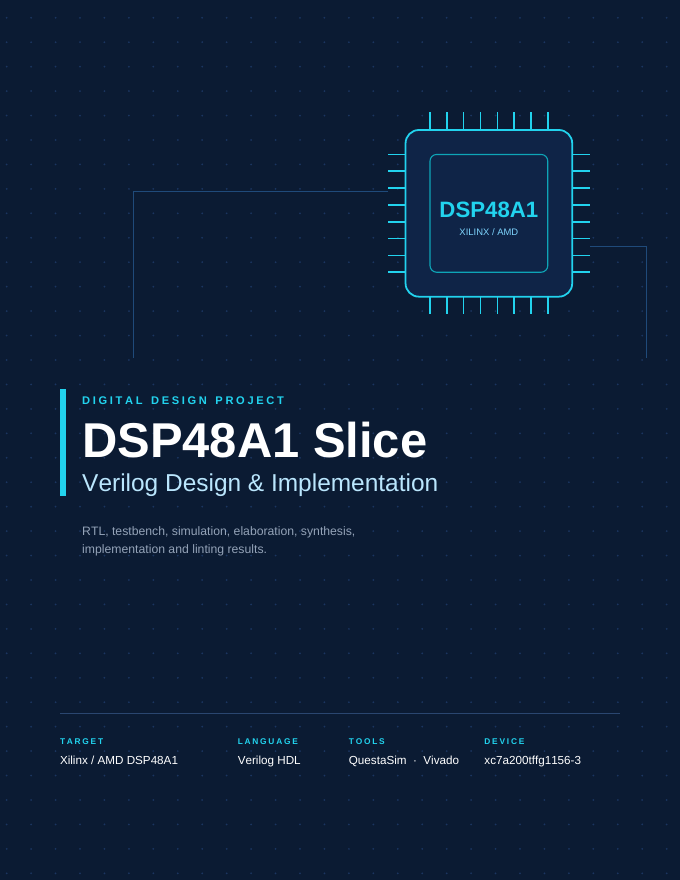

# DSP48A1 Slice: Verilog Design & Implementation

Parameterised Verilog model of the Xilinx (AMD) Spartan-6 **DSP48A1** slice, verified with QuestaSim and taken through the Vivado flow (elaboration, synthesis, implementation, linting).

**[Open the full project report (PDF)](DSP48A1_Project_Report.pdf)**

## What is inside

| Folder | Content |
|---|---|
| `RTL/` | Verilog source of every module |
| `Testbench/` | Testbench (`pro_1_tb`) |

## Modules

| Module | Role |
|---|---|
| `pro_1` | Top level: multiplier, M and CARRYIN registers, X/Z multiplexers, carry-in select |
| `input_data` | Input stage: D, B0, C, A0, OPMODE registers, pre-adder/subtractor, B1 and A1 registers |
| `output_data` | Output stage: post-adder/subtractor, P and CARRYOUT registers |
| `multiplier` | WIDTH × WIDTH multiplier |
| `add_sub` | Adder/subtractor with carry in and out |
| `pipline_mux` | Registered or bypassed path, selected by `PIPLINE` |
| `register` | Register with enable and sync/async reset |

## Tests

`pro_1_tb` runs five self-checking tests (2.1 reset, 2.2 to 2.5 four DSP paths selected through `OPMODE`). The test plan, expected values and data-flow figures are in the report.

## Results

| Metric | Post-synthesis | Post-implementation |
|---|---|---|
| Slice LUTs | 273 | 273 |
| Slice registers | 160 | 179 |
| DSP blocks | 1 | 1 |
| WNS | 5.216 ns | 3.716 ns |
| WHS | 0.182 ns | 0.262 ns |

Target device: `xc7a200tffg1156-3`, clock constraint 10 ns (100 MHz). All timing constraints are met and linting reports no errors.

## Tools

QuestaSim, Vivado, Verilog HDL.
